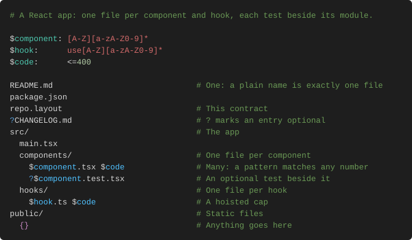

# Layout

`layout` checks a repo's tree against `repo.layout`, a contract that reads like a
directory listing, and exits 1 on drift.

[](https://github.com/zaydek/layout/actions/workflows/layout.yml)

## Install

layout installs as a plugin in your agent, which carries the binary and a skill that
teaches the agent the grammar, every lint finding and how to fix drift.

| Host | Install | Update | Uninstall |
| ---- | ------- | ------ | --------- |
| Claude Code | `claude plugin marketplace add zaydek/layout` then `claude plugin install layout@layout` | `claude plugin marketplace update layout` then `claude plugin update layout@layout` | `claude plugin uninstall layout@layout` |
| Codex | `codex plugin marketplace add zaydek/layout` then `codex plugin add layout@layout` | `codex plugin marketplace upgrade layout` | `codex plugin remove layout@layout` |
| omp (oh-my-pi) | `omp plugin marketplace add zaydek/layout` then `omp plugin install layout@layout` | `omp plugin upgrade layout@layout` | `omp plugin uninstall layout@layout` |
| OpenCode | Not yet: OpenCode loads plugins from npm, and layout is not on npm yet | | |

The first run fetches the release for your machine from
[Releases](https://github.com/zaydek/layout/releases) and checks its sha256 before it
runs. The binary then lives at `~/.local/share/layout/bin/layout` (and `~/.local/bin/layout`
when that folder exists), where git hooks and editors find it.

macOS on Apple silicon, Linux x86_64 and Linux arm64. Windows and Intel Macs are not
supported.

## Grammar

```text
$component: [A-Z][a-zA-Z0-9]*
$hook:      use[A-Z][a-zA-Z0-9]*
$code:      <=400

README.md                              # One: a plain name is exactly one file
package.json
?CHANGELOG.md                          # ? marks an entry optional
src/
  main.tsx
  components/
    $component.tsx $code               # Many: a pattern matches any number
    ?$component.test.tsx               # An optional test beside it        
  hooks/
    $hook.ts $code                     # A hoisted cap
public/
  {}                                   # Anything goes here
docs -> ../docs                        # A symlink
```

## Example



## Commands

```sh
layout .                   # Check this tree; exit 1 on drift
layout lint repo.layout    # Check the contract's own syntax
layout format              # Rewrite the contract to house style
layout format --check      # Exit 1 if format would change it
```

Exit codes: 0 the tree matches, 1 drift, 2 layout could not run or the contract is broken.

## CI and hooks

```yaml
- uses: actions/checkout@3d3c42e5aac5ba805825da76410c181273ba90b1 # v7.0.1
  with:
    fetch-depth: 0
- uses: zaydek/layout/.github/actions/layout@<commit sha>
  with:
    version: 0.1.0
```

The action pins the version, checks the binary's sha256, caches it, and marks each
finding on its file in the pull request. pre-commit: `repo: https://github.com/zaydek/layout`,
hook `layout`. Other CI systems and hooks: [ci.md](skills/layout/reference/ci.md).

## Docs

[The skill](skills/layout/SKILL.md) is the full reference: the grammar, commands, every
lint finding, writing a contract, recipes, and CI. [llms.txt](llms.txt) indexes it.

## License

Free to use; no redistribution ([LICENSE](LICENSE)). The editor extension in
[extension/](extension/) is MIT.
