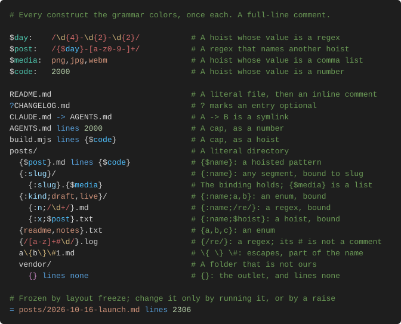

# Layout

`layout` checks a repo's tree against `repo.layout`, a contract that reads like a
directory listing, and exits 1 on drift.

## Install

Releases and an installer will be published here.

## Grammar

```text
$kind:    user|feedback|project|reference|threads|idea
$project: z|life|annotate|chippy
$memory:  {$kind}_{$project}_$std:kebab_$std:date
$code:    <=2,000

memories/
  ?.archive/
    {}                                   # Anything goes here
  $memory.md                             # Many: a pattern matches any number of files
  INDEX.md                               # One: a plain name is exactly one file
  memory.md                              # No cap given, so no cap
src/
  $std:kebab.ts $code                    # A hoisted cap
docs -> ../docs                          # A symlink
```

- `$name: regex` hoists a bare regex, `|` for alternatives, at the top only.
- `name` is required, `name/` is a folder, `?name` is optional, `{}` is anything,
  `A -> B` is a symlink.
- `$name` ends at the first character outside `[A-Za-z0-9_]`; write `{$name}` when a
  word character follows. `\$` is a literal dollar.
- The same `$name` twice in one subtree matches the same text.
- A trailing `<=2,000` or `$code` caps a file in lines; no cap means no cap. The
  frozen block is `= path <=N`.
- Comments start at column 40 at least and wrap at 80, continuing under the first `#`.

## Standard library

Every contract can name these with no hoist.

| Name | Regex | Example |
| --- | --- | --- |
| `$std:date` | `\d{4}-\d{2}-\d{2}` | `2026-10-16` |
| `$std:kebab` | `[a-z0-9]+(-[a-z0-9]+)*` | `grammar-v2` |
| `$std:semver` | `\d+\.\d+\.\d+` | `0.2.2` |
| `$std:v` | `v[1-9]\d*` | `v2` |
| `$std:int` | `\d+` | `8166` |
| `$std:screaming` | `[A-Z][A-Z0-9_]*` | `README_V2` |
| `$std:pascal` | `[A-Z][a-zA-Z0-9]*` | `ButtonGroup` |
| `$std:camel` | `[a-z][a-zA-Z0-9]*` | `buttonGroup` |
| `$std:snake` | `[a-z0-9]+(_[a-z0-9]+)*` | `user_feedback` |
| `$std:stamp` | `\d{8}-\d{4}` | `20261016-1530` |
| `$std:utctime` | `\d{2}-\d{2}-\d{2}Z` | `15-30-00Z` |

## Example



## Commands

```sh
layout .                   # Check this tree; exit 1 on drift
layout fmt [file]          # Rewrite a contract to house style
layout lint <file>         # Check a contract's own syntax
layout freeze              # Freeze the files already over their caps
layout render [file]       # Print a contract, or draw findings JSON
```
