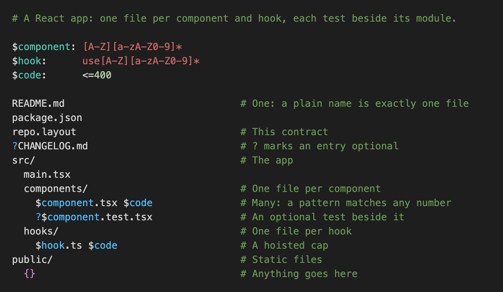

# Layout for VS Code and Cursor

Highlighting, lint diagnostics and formatting for `repo.layout`, the contract
[layout](https://github.com/zaydek/layout) checks a repository's file tree against.

## Features

- **Highlighting** for `*.layout` and `repo.layout`: hoisted regexes, `$name` slots, caps, symlinks,
  `{}`, comments and escapes. Works with no binary installed.
- **Lint diagnostics**: each `layout lint` finding appears on its line when a contract is opened or
  saved, with its code.
- **Format Document** runs `layout format`, respecting the contract's `.layout.config`.
- **Layout: Check This Workspace** runs `layout .` and prints the findings in the Layout output.

## The binary

Lint, format and check run the layout binary; the extension never downloads one. It looks, in
order, at the `layout.path` setting, `$LAYOUT_BIN`, `layout` on PATH, and
`~/.local/share/layout/bin/layout`, where the layout plugin for Claude Code, Codex and omp keeps
it. Install the plugin once ([install](https://github.com/zaydek/layout#install)) and the extension
finds it.

The binary runs on macOS (Apple silicon) and Linux. On Windows, highlighting works and the rest is
off. In an untrusted workspace the binary is never run.

## License

MIT. The layout binary itself is under its own license.
